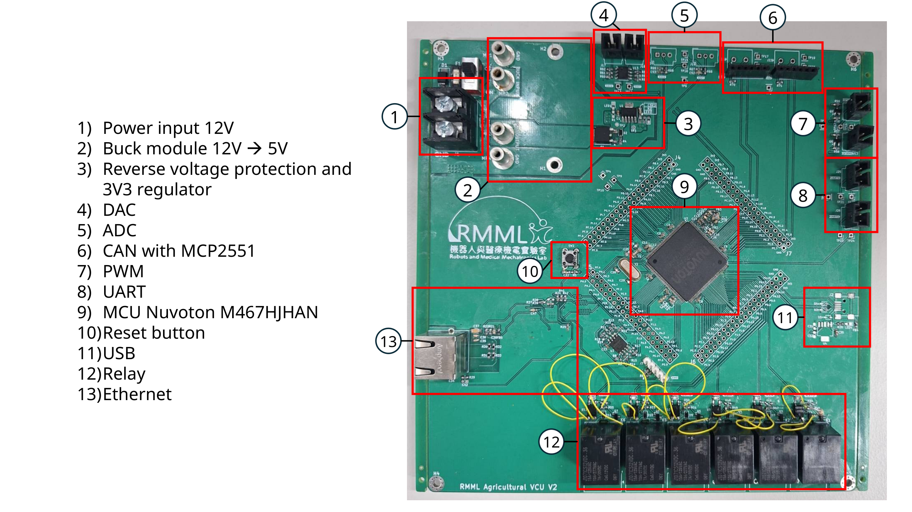

# Agricultural VCU V2

Vehicle control unit PCB for agricultural robots and machinery, built around the Nuvoton M467HJHAN microcontroller. V2 provides Ethernet, CAN, UART, ADC/DAC, PWM, and six relay channels.

The project was originally designed in **KiCad 8** and has been updated to **KiCad 10**. The current schematic and PCB files identify KiCad 10.0 as their generator.

**Hardware status:** V2 is conditionally functioning and requires relay rework. Test Report Rev. A also identifies mechanical issues that make this revision unsuitable for field applications in its current condition. See [validation and known issues](#validation-and-known-issues) before assembling or using a board.

## Board overview

Converted from the single slide in [Presentation1.pptx](docs/references/Presentation1.pptx). The photograph shows the assembled board with relay rework wiring.

## Hardware

| Item | V2 design |
| --- | --- |
| MCU | Nuvoton M467HJHAN, Arm Cortex-M4, LQFP176 |
| Power | 12 V input, external 12 V to 5 V buck module, TPS79533 3.3 V regulator |
| Input protection | Fuse, power switch, and unidirectional TVS diode |
| Ethernet | RTL8201FI PHY, RMII connection to the MCU, magnetics, and RJ45 connector |
| CAN | Two interfaces using external MCP2551 transceiver modules |
| UART | UART0 and UART2 connectors |
| Analogue interfaces | Two ADC inputs with 5 V to 3.3 V scaling and two DAC output channels |
| PWM | Two outputs, BPWM0_CH0 and BPWM1_CH0, with BSS138 level shifting |
| Relays | Six 12 V SPDT channels with optocoupler-based drivers; rework required |
| Expansion and debug | Four 2×20 GPIO sockets and a Nu-Link SWD header |
| Storage | External SPI flash; the V1 SD-card module connector was removed |
| PCB | Four layers, 176.53 × 184.15 mm, 2 mm thick |
| Fabrication limits | 0.1 mm minimum track width/spacing and 0.2 mm minimum hole diameter |

Connector pinouts, switches, LEDs, and test points are listed in the [user manual](docs/references/user-manual.pdf). Relay contact wiring must also account for the pin-order issue below.

## Project files and KiCad setup

Open [UGV Control Unit.kicad_pro](UGV%20Control%20Unit.kicad_pro) with KiCad 10 to work with the current project.

| File | Contents |
| --- | --- |
| [UGV Control Unit.kicad_sch](UGV%20Control%20Unit.kicad_sch) | Root schematic |
| [UGVPower.kicad_sch](UGVPower.kicad_sch) | Power supply |
| [UGVMCU.kicad_sch](UGVMCU.kicad_sch) | MCU, clocks, debug, USB, and flash |
| [UGVGPIO.kicad_sch](UGVGPIO.kicad_sch) | Relays and external interfaces |
| [UGVEthernet.kicad_sch](UGVEthernet.kicad_sch) | Ethernet circuitry |
| [UGV Control Unit.kicad_pcb](UGV%20Control%20Unit.kicad_pcb) | PCB layout |
| [bom/ibom.html](bom/ibom.html) | Interactive BOM and component placement |
| [UGVPCBGerber.zip](UGVPCBGerber.zip) | Existing Gerbers and manufacturing data |
| [UGV Control Unit-odb.zip](UGV%20Control%20Unit-odb.zip) | Existing ODB++ export |
| [Top placement](UGV%20Control%20Unit-top.pos) / [bottom placement](UGV%20Control%20Unit-bottom.pos) | Component position files |
| [3D model.zip](3D%20model.zip) | Complete board STEP model |

The design references custom symbol/footprint libraries, including `MCU_Nuvoton_M467`, `TPS79533DCQ`, and `DESD5V0U1BA_7`. Configure the required libraries when editing or updating components. Some PCB 3D-model paths still use `${KICAD8_3DMODEL_DIR}`; check those paths in KiCad 10 if individual component models are missing. The STEP archive contains the complete board model.

## Changes from V1 to V2

The [Version Control Report](docs/references/version-control-report.pdf) documents the hardware changes from V1 (February 2025) to V2 (January 2026). This hardware revision history is separate from the KiCad 8-to-10 software migration.

| Area | V1 | V2 |
| --- | --- | --- |
| MCU | STM32F446RE, LQFP64 | Nuvoton M467HJHAN, LQFP176 |
| Clocks | 8.192 MHz external crystal; external RTC clock unused | 12 MHz external crystal and external RTC clock |
| Power input | Four-pin connector for 12 V, 72 V, and grounds | Two-pin 12 V/GND connector; added TVS protection |
| MCU supply | VCAP routing mistake required a manual trace cut | LDO_CAP pins kept separate from the 3.3 V rail |
| Decoupling | 0402 capacitors | 0603 capacitors to ease assembly |
| GPIO expansion | One 2×13 and three 2×12 sockets, with 3.3 V and 5 V power pins | Four 2×20 sockets, with 3.3 V power pins |
| Debug | STM32 SWD and boot-jumper circuitry | M467 SWD on PF.0/PF.1 with external pull-ups; simplified boot circuitry |
| Ethernet | Unused | Added PHY, magnetics, and RJ45 interface |
| Relays | 12 relays, BJT-based drivers, D-sub/terminal-block connections | Six SPDT relays, optocoupler-based drivers, individual terminal blocks |
| Interfaces | ADC, DAC, CAN, one UART, and SD-card module connector | Retained ADC/DAC/CAN; two UARTs and two PWM outputs; removed SD-card module connector |
| Storage and USB | No external flash; USB shield directly grounded | Added SPI flash; USB shield connected through a ferrite bead |
| Layout | 180 × 180 mm; components on the top layer | 176.53 × 184.15 mm; some Ethernet components on the bottom layer, edge connectors, and teardrops at small vias |

## Validation and known issues

The following results summarize the supplied [PCB Test Report Rev. A](docs/references/pcb-test-report-rev-a.pdf), revised **22 June 2026**. They describe laboratory testing of the evaluated board; the interfaces were tested independently with separate firmware.

| Function | Reported result |
| --- | --- |
| Power | Measured 12 V, 5.03 V, and 3.33 V. The 12 V and 5 V rails were supplied independently because buck-module stock was limited. |
| SWD and MCU | MCU detection and APROM programming succeeded with the NuMicro ICP Programming Tool. |
| GPIO | Selected GPIO outputs successfully toggled an external LED. |
| Relays | Functioned after correcting optocoupler wiring and changing the low-voltage-side pull-up to 5 V. |
| PWM | Both outputs worked. The report records slower rising edges after the level shifter: approximately 700 ns with a 10 kΩ pull-up and 440 ns with 1 kΩ. |
| ADC | Both channels covered 0–4095 counts over the tested 0–5 V connector input range. |
| DAC | Both channels produced the expected sine waves with a 180° relative phase shift; a small DAC1 spike was observed. |
| UART | UART0 transmission worked. UART2 did not produce the expected result and requires further firmware/setup verification. |
| CAN | Bidirectional CAN0/CAN1 communication passed on one board using two MCP2551 transceivers. |
| Ethernet | Rev. A shows four successful ping replies with 0% packet loss. PHY supply measurements and QFN exposed-pad soldering are discussed in Section 5.8. |

### Relay rework

- **Optocoupler footprint:** pins **3 and 4 are swapped**. Existing boards need rework on the optocoupler output side to restore the intended connections. Rev. A, Section 5.2, shows the corrected pin arrangement.
- **Pull-up voltage:** the reported working configuration uses **5 V** on the low-voltage side. The report records no switching at 3.3 V and an always-on relay at 12 V.
- **Contact order:** the Version Control Report and August evaluation identify the existing left-to-right terminal order as **NC–COM–NO**, while the intended order is **NO–COM–NC**. Verify the actual contacts before wiring loads.

**Source discrepancy:** the supplied Testing Protocol's relay rework section specifies a 12 V pull-up. This conflicts with the measured results in Test Report Rev. A and the 5 V recommendation in the August evaluation. Use the Rev. A findings and corrected pin arrangement when reviewing the rework; the protocol's 12 V instruction should not be used as the working configuration.

### Power and mechanical follow-up

The report records initial 3.3 V rail instability and stabilization after removing regulator output capacitor C3 during troubleshooting. This observation is part of the laboratory test history; regulator stability still needs the proof-of-concept work identified in the evaluation. The report also calls for better buck-module cable clearance and easier component assembly before field use.

For assembly, power checks, SWD setup, and individual interface test procedures, refer to the [Testing Protocol](docs/references/testing-protocol.pdf), with the relay discrepancy above taken into account. Test firmware was based on the [Nuvoton M460 BSP examples](https://github.com/OpenNuvoton/m460bsp/tree/master/SampleCode/StdDriver).

## V2 evaluation and considerations for V3

[20260810_Rai.pptx](docs/references/20260810_Rai.pptx), **“V2 Evaluations for V3”**, was presented by Angelique Raihany Hadiva on **10 August 2026**. Its original location was identified as `season 2/projects/presentation/20260810_Rai.pptx`; a copy is included here for reference. It evaluates this V2 board and lists proposed changes for V3. These proposals are not completed V2 changes.

| Evaluation area | Follow-up proposed in the presentation |
| --- | --- |
| Power | Retain TPS79533, validate the supply in simulation and hardware, and investigate replacing the buck module with a buck IC such as TPS62933. The optional test board moves reverse-voltage protection to the 12 V rail and adds removable current-measurement links. |
| Copper pours | Use thermal reliefs where appropriate to improve soldering of ground pads. |
| Relays | Correct optocoupler pins 3/4, the NO/NC contact order, and the 5 V pull-up arrangement. |
| USB | Address the missing FSUSB_VBUS connection to PA.12 for device VBUS detection. If host/OTG support is added, provide controlled, protected VBUS switching. |
| Test points and GPIO expansion | Add test points before and after PWM/DAC interface stages; review RMII routing through expansion-header pads and the resulting routing distance/stubs. |
| CAN and SD card | Evaluate embedding the CAN interface and restoring SD-card support to reduce reliance on external modules. |
| Ethernet and assembly | Review compatible magnetics and top-layer PHY/transformer placement to simplify assembly. |

The August USB evaluation identifies VBUS sensing as necessary even for device operation, revisiting the Version Control Report's earlier rationale for omitting it. USB functionality is not reported as validated in Test Report Rev. A.

## Reference documents

| Source | Purpose |
| --- | --- |
| [Presentation1.pptx](docs/references/Presentation1.pptx) | Original annotated board overview, rendered above as a PNG |
| [Agricultural VCU V2 User Manual](docs/references/user-manual.pdf) | Pin assignments, connectors, switches, LEDs, test points, and schematics |
| [Agricultural VCU V2 Testing Protocol](docs/references/testing-protocol.pdf) | Assembly and laboratory test procedures; see the relay discrepancy above |
| [Agricultural VCU v2 PCB Test Report Rev. A](docs/references/pcb-test-report-rev-a.pdf) | Measurements, interface results, rework findings, and remaining issues |
| [Agricultural VCU V2 Version Control Report](docs/references/version-control-report.pdf) | Changes from hardware V1 to V2 |
| [20260810_Rai.pptx](docs/references/20260810_Rai.pptx) | V2 evaluation list and V3 considerations from the August lab meeting |
